---
title: "Case #3: Want faster requests? Just lower the timeout and watch the p99 drop"
series: "The Algorithm Decided"
reviewer: Yannick Kirschhoffer
tags: ["The Algorithm Decided"]
prev_post: 2026-10-23-algo-regression-to-mean
next_post: 2026-11-03-algo-feedback-loops
image: /assets/algorithm-decided/self-selection-loud-customers.png
biblio:
  - link: https://ankursethi.com/blog/your-analytics-are-lying-to-you/
    title: "Ankur Sethi: Your analytics are lying to you"
  - link: https://plausible.io/blog/google-analytics-adblockers-missing-data
    title: "Plausible: 58% of Hacker News, Reddit and tech-savvy audiences block Google Analytics"
  - link: https://news.ycombinator.com/item?id=28365163
    title: "Hacker News discussion: Tech-savvy audiences block Google Analytics (2021, 1,214 points, 681 comments)"
  - link: https://en.wikipedia.org/wiki/Census
    title: "Wikipedia: Census"
  - link: https://en.wikipedia.org/wiki/Convenience_sampling
    title: "Wikipedia: Convenience sampling"
  - link: https://markosaric.com/google-analytics-blocking/
    title: "Marko Saric: 13% of my website visitors block Google Analytics"
  - link: https://survey.stackoverflow.co/2025/
    title: "Stack Overflow Developer Survey 2025"
  - link: https://lp.jetbrains.com/developer-ecosystem-2025-methedology/
    title: "JetBrains: State of Developer Ecosystem 2025, methodology"
  - link: https://github.blog/news-insights/octoverse/octoverse-a-new-developer-joins-github-every-second-as-ai-leads-typescript-to-1/
    title: "GitHub Octoverse 2025: A new developer joins GitHub every second as AI leads TypeScript to #1"
  - link: https://bookdown.org/mwheymans/bookmi/missing-data-mechanisms.html
    title: "Heymans & Eekhout: Applied Missing Data Analysis, Missing data mechanisms (MCAR, MAR, MNAR)"
  - link: https://en.wikipedia.org/wiki/Missing_data
    title: "Wikipedia: Missing data"
  - link: https://en.wikipedia.org/wiki/Truncation_(statistics)
    title: "Wikipedia: Truncation (statistics)"
  - link: https://www.youtube.com/watch?v=lJ8ydIuPFeU
    title: "Gil Tene: How NOT to Measure Latency (Strange Loop, video)"
  - link: https://www.scylladb.com/2021/04/22/on-coordinated-omission/
    title: "ScyllaDB: On Coordinated Omission"
  - link: https://www.latimes.com/business/technology/la-fi-tn-facebook-video-metrics-20181017-story.html
    title: "LA Times: Facebook encouraged media companies to invest in video. A lawsuit alleges it wasn't worth it (2018)"
--- 

Do you know how your users are using your product? _"Yes... we have analytics on the page, so we know everything: clicks, pages, browsers, countries."_

_"In fact, it says right here that **only 2% of our users are on Firefox.** Logically, we can drop support for Firefox, since supporting 2% of users isn't worth it for us."_

Yes, this is a smart, logical, data-driven business decision... _unless_ the analytics tool is hiding users from you. But can it do that?

**How much do you trust your analytics tools?**

## Do analytics tools tell the whole truth?

**No. Of course, they don't. They show you the users they are able to record.** And this will _never be all_ the visitors to your pages. 

Some people **block trackers**, or they just don't click "accept cookies" on the warning banner. A **JS error** elsewhere on the page can also block the analytics tool from loading. Or maybe the **page was slow** and the analytics JS code simply never loaded. Or maybe they are behind a **DNS blocker** or **a corporate firewall**. Or maybe the user came via an **[RSS reader](https://en.wikipedia.org/wiki/News_aggregator) or [a read-later app](https://en.wikipedia.org/wiki/Instapaper)** or some other tool that shows a **cached version** of your page to the user, making no actual real-life requests to your pages. Or maybe the analytics tool **dropped the event**, maybe you were simply over your quota, or they had an incident and dropped some events.

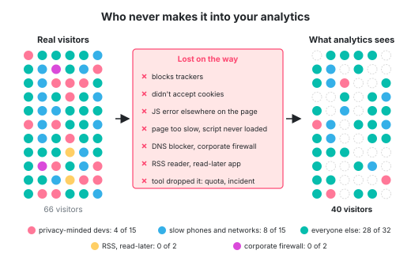

The reasons are many, but the end result is that you just cannot get the full picture of everybody who landed on your pages.

**Sure, but are the captured users at least a good representation of all users?**

**Also no.** Or at least not necessarily. 

In 2021, the company Plausible (who makes an analytics tool, so we don't know how much they can be trusted) wrote a blog post that went viral on [Hacker News](https://news.ycombinator.com/item?id=28365163). They counted the same visitors with their own tool and with Google Analytics:

| Browser | Plausible counted | Google Analytics counted | GA missed |
|---------|------------------:|-------------------------:|----------:|
| Chrome  |            16,405 |                    8,133 |       50% |
| Safari  |            16,136 |                    9,454 |       41% |
| Firefox |            15,192 |                **1,780** |   **88%** |
| Edge    |             1,059 |                      301 |       72% |
| _Total_ |          _48,792_ |                 _19,668_ |     _60%_ |
{:.last-row}

<figcaption>
&mdash; <a href="https://plausible.io/blog/google-analytics-adblockers-missing-data">Plausible, 2021</a>
</figcaption>

Their count showed that Firefox users were **about a third** of the visitors from these browsers. However, in Google Analytics, they were **less than a tenth**.

Interestingly, people didn't find this all too controversial. The debate mostly focused on what all the reasons could be.

Basically, **how many people your analytics misses depends a lot on who your users are.** 

People who choose Firefox often also prefer to block ads and trackers.

So when your data says 2% of your users are on Firefox, what it's actually saying is: **of the users who aren't blocking us, 2% are on Firefox**.

## How much coffee does the average Parisian drink per day?

Can I get to this answer if I just **pick a random square in Paris, stay there for 4h and ask every passer-by for their answer?**

**No.**

Because I never got the "average Parisian", **I only got the people who had a reason to walk across that square**. No matter which square I chose, most Parisians don't frequent that particular square daily. 

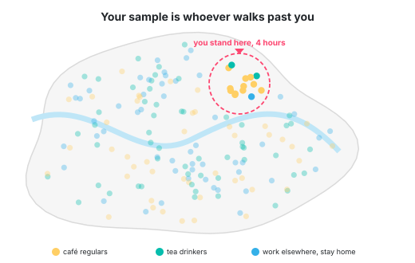

If I wanted the true answer, I would need a random sample: **a way of picking people where every single Parisian has the same chance of being asked. The ones who work from home, the ones who never leave their neighborhood, the ones who only drink tea... all of them.**

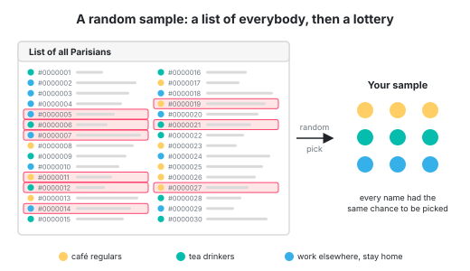

## Convenience sampling

**Every dataset is a sample,** unless you counted everybody, in which case it's a census. But in the real world, even a census is most often just a very, very big sample.

Here are some useful terms:

- **Population:** who we actually want to know about. All the people using our product.
- **Sampling frame:** who we are able to reach. The people whose browser runs our analytics script.
- **Sample:** who actually ended up in the data. Everybody who could have been in the data, but isn't, is **non-response**.

In IT, we *love* to do a so-called **convenience sample** or **opportunity sample**. This is a sample that consists of whoever was easy to reach. 

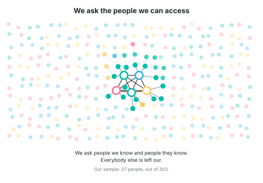

The problem with this approach is the old saying **"birds of a feather flock together"**. 

People you know aren't a good representation of the general society. You have too much in common with them.

Many years ago, some journalists asked some politicians in the Slovenian parliament **how much a cup of coffee costs**. Their responses went viral, because they were sooooooooo faaaaaar out of touch with reality, their guesses were far, far too low. The problem was that the parliament's coffee shop sold coffee for peanuts, how were they supposed to know what the outside price was, when they never went outside? My point is: you could have gone up and down the parliament building and asked every single person inside, but you wouldn't have gotten a representative sample for the country. 

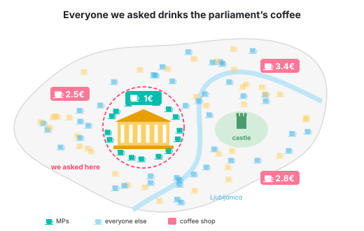

Stop asking mainly your friends to rate your work!

**We want numbers, we need them to make data-driven decisions, and we don't know much about the intricacies of population sampling... so we aren't bothered by convenience sampling.**

**As long as we get some numbers, we'll generally happily assume the numbers are close enough.** 

## Which data did we miss?

We like to think statistics starts when we type `avg()`. But by then, many decisions were already made... by whatever collected the data.

We readily use the mean to aggregate data, even when the median or other measures might better answer the question. But **choosing a good metric is not enough if the underlying data doesn't represent the population we're interested in.**

To understand the shortcomings of your dataset, ask yourself: how did we get the data?

And more particularly: **which data did we fail to collect?**

**If _we_ don't pick our sample, the sample will pick itself.** Here are 2 ways this happens (with their official terms):

1. **Non-response and self-selection:** who didn't answer our survey, and who answered without being asked?
2. **Truncation and censoring:** what do our own limits cut off?

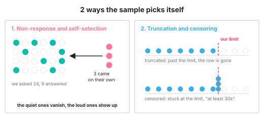

## Non-response and self-selection

Recently I've been asked in an interview **if the particular project I built was popular with the customers or not**. The problem was... I had no data to base any claims on. I remembered **some Slack msgs** we got from some happy customers and then also some feature requests from some other customers. 

Are these good datapoints to confidently say people liked the project?

**All my datapoints have self-selected.** This meant they were unreliable. 

I didn't get the opinion of the average customer, I got only the opinion of 2 subtypes of customers: 
- the group: "we are using your feature, but we need an **extra** button" and
- the group: "we are **vocal** about our likes and dislikes".

All the other customers remained silent (they can be counted under non-response).

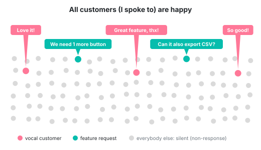

From the data I have, I can accurately say: _"all the customers I talked to were either already using the feature or they expressed liking it"_. Given my data, this is 100% the truth.
{:.box-yellow}

Of course this goes well beyond computing. Think about politics: might the state of the world be better, if we selected politicians with a lottery from the pool of all citizens, instead of choosing from a self-selected group of people, who are actively seeking power.

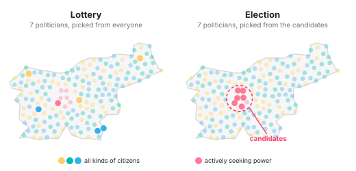

## MCAR, MAR, MNAR and why privacy-conscious people are always missing from stats

In 1976, the statistician Donald Rubin sorted data missing from datasets into three types. They have terrible names, but the idea behind them is simple.

- **Missing completely at random (MCAR).** The analytics tool randomly loses 1% of the data points. This is annoying, but harmless, because the lost datapoints look just like the ones we captured, which makes our sample representative of the whole population. 
- **Missing at random (MAR).** The old version of the analytics tool doesn't report the screen size. The gaps aren't random, but we know exactly why they're there, because we record which version each user runs. So we can split users by version and work around the missing screen sizes.
- **Missing not at random (MNAR).** Privacy-conscious people have ad-blockers, our analytics tool can't see them, thus they are missing from our data. The reason _why_ they are missing is directly related to the fact _that_ they are missing from the dataset.

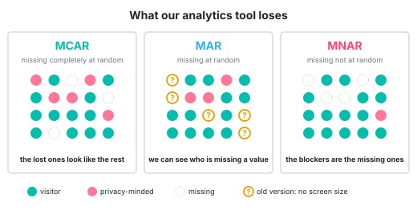

**MNAR is the tricky one that we should pay more attention to, because there's nothing in the data that tells us who's missing!**

## Truncation and censoring

Have you ever designed a public API? Then you must have also dealt with **rate limiting your API consumers**.

Let's say we have 2 teams in our vast company: one team, in room 504, is analyzing customer behavior, while a different team, in room 222, in building F, is deciding on the behavior of the rate limiters.

Now the analyzing team proudly declares that we can scale down our server architecture, because no customer ever makes more than 100 req/min. **They have data, they have charts.**

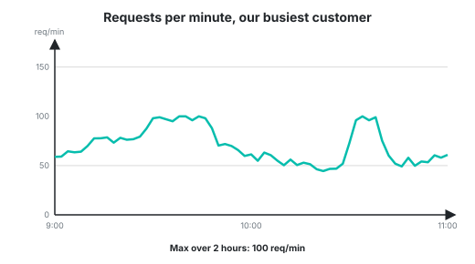

What they don't have is information about the rate-limiters. They don't know **we limit the requests to 100/min**. The customers would love to call our APIs more often. 

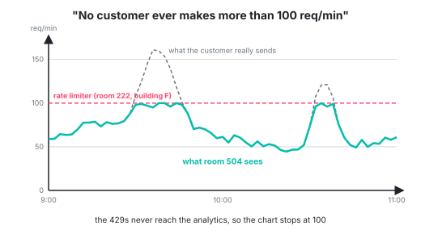

**Our mistake was that we don't log requests over the limit in the same way, thus the analytics team wasn't able to pick them up.**

**We were censoring and truncating.** 

Censoring means that our **metric's values have an upper or lower bound** (in our case 100 req/min per customer).

Truncating means that we simply **don't record some values** (in our case we dropped the 101st, 102nd, ... request for every customer).

(This is close to survivorship bias: **what's missing from our observations may be exactly what would change our conclusion.**)

## Truncation on purpose

**But sometimes, your customers explicitly ask for truncation.**

At this one company I worked at, we calculated DORA metrics for customers (imagine "average PR lead time" and such).

As soon as customers started using them, they also came up with an interesting feature request: "**Can we ignore some PRs?**" Specifically the bot PRs, like the PRs from Dependabot. Those mess up the numbers.

Of course, we did build this, their own little stats-tweaking lever. But we made sure to be extremely transparent about showing and hiding the "truncated" PRs. 

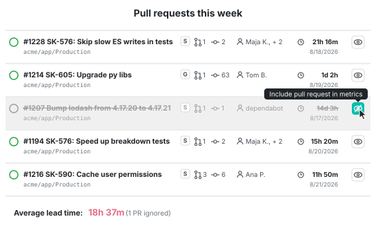

## Can you spot the truncation and the censoring?

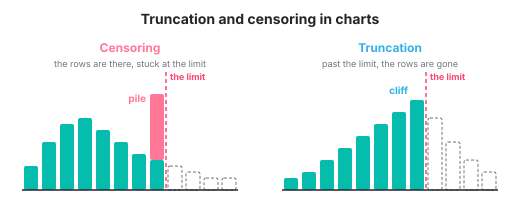

Here are some similar ways in which we fool ourselves:

####  "Our p99 is exactly 60 seconds."

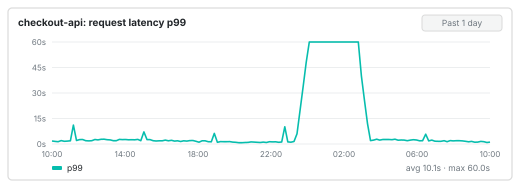

Yes, but that's the load balancer timeout. Physically the requests can't be longer. Every request that would have taken 2 minutes gets logged as 60s.

####  "This bug started happening 30 days ago. There are no signs of it before that."

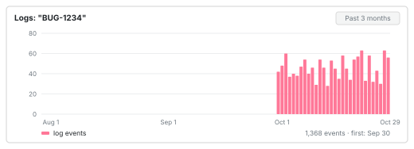

Yes, because the log retention is 30 days. We simply don't have older logs. All we know is that the bug is _at least_ 30 days old. 

####  "Our queue never has more than 10,000 messages."

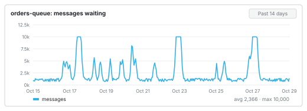

Yes, because that is its limit. The message 10,001 was dropped. 

####  "Nobody ever uploaded a file over 10MB."

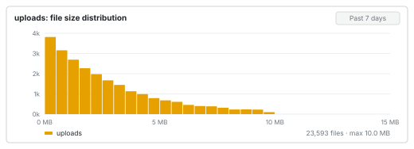

Yes, because the load balancer rejects files over 10MB.

####  "All our oldest customers joined in March 2019."

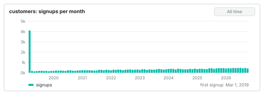

That is when we migrated the database, and older signup dates got set to the migration day. **This is why I always set the default date in migrations to 1970-01-01, because I hope it immediately reads like wrong data to people.**

####  "Nobody's address is longer than 255 characters."

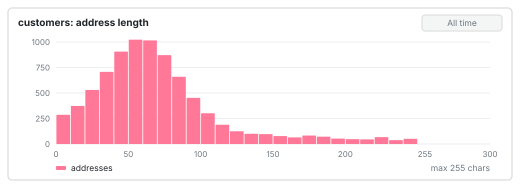

True. However, the DB column is a varchar(255), so it physically can't store a longer value.

####  "The nightly job got faster this week."

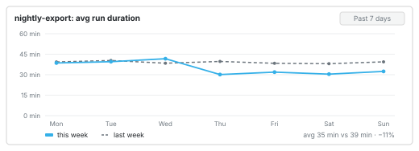

True, but only because the longest runs were killed by the timeout, and we don't record the duration in that case.

## Coordinated omission, or why your latency numbers lie

While reading about latency, I came across this interesting term: **coordinated omission**. It comes from Gil Tene, who has been talking about it since at least 2013.

> Coordinated omission is a term coined by Gil Tene to describe the phenomenon when the measuring system inadvertently coordinates with the system being measured in a way that avoids measuring outliers.
<figcaption>
&mdash; <a href="https://www.scylladb.com/2021/04/22/on-coordinated-omission/">ScyllaDB, 2021</a>
</figcaption>

In other words: **_the thing we measure_ and _the thing that does the measuring_ accidentally coordinate and skew the result.**

Here's how that happens:

- We want to know **how long our API takes** to answer a request.
- Our load-testing tool **sends a request, waits for the answer**, and only then sends the next one.
- Normally, the system answers every request in **1ms**, and the tool **sends 1 request per second**.
- Then suddenly, the system freezes for 100 seconds.

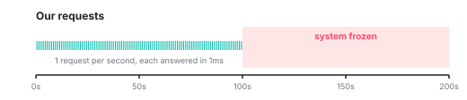

- The tool's current request is **stuck, waiting 100 seconds** for its answer.
- And since the tool only sends a new request after it gets the answer to the old one... it sends nothing else during those 100 seconds.

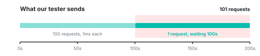

- After the test, we have **101 requests: 100 that took 1ms and 1 that took 100 seconds**. The average is about 1 second, and the p99 is 1ms.
  
  | Count        | Avg | p99 | Max  |
  |--------------|-----|-----|------|
  | 101 requests | 1s  | 1ms | 100s |

- But **real customers don't wait for each other**. They keep coming at 1 request per second. The first one waits 100 seconds, the next one 99, then 98... and the last one only 1 second.

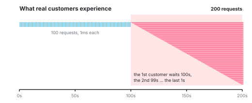

- So **in reality, we would have had 200 requests**, an average of about 25 seconds, and a p99 of about 98 seconds. **One in four customers waited more than 50 seconds.**
  
  $$\text{avg} = \frac{100 \times 1\text{ms} + 100\text{s} + 99\text{s} + \dots + 1\text{s}}{200} \approx 25\text{s}$$
  
  | Count        | Avg | p99 | Max  |
  |--------------|-----|-----|------|
  | 200 requests | 25s | 98s | 100s |
  {:.table-center}

  To get the p99, we sort all values and take the one at position 99% × 200 = 198, which is 98s.

And in reality it can get even worse: a slowdown can cause in-flight requests to accumulate, which then makes the degradation worse. A tool that waits for each request to finish before sending the next one risks hiding precisely that dynamic.

## The time people lost jobs because of truncated datapoints

**Sometimes our statistical shenanigans create serious consequences for other people. By the time we realize this, it is usually too late.**

Around 2015 and 2016, Facebook was encouraging media companies to invest in video, to switch from text content to video content. Facebook said that's what people wanted. They had numbers to back it up: the **"average duration of video viewed"**.

Publishers (Vice, Fox Sports, Mic) reacted to these numbers and cut writers to put the money into video.

> I've worked tirelessly for years without any resources or networks in pursuit of the written word. So, it's soul-crushing to see all of that work and suffering [...] gone in exchange for 30-second low-grade Windows Movie Maker videos because some faceless entity provided false numbers to media executives.
<figcaption>
&mdash; Sarah Harvard, laid off from Mic in 2017, in the <a href="https://www.latimes.com/business/technology/la-fi-tn-facebook-video-metrics-20181017-story.html">LA Times</a>
</figcaption>

But there was 1 problem with these numbers. Facebook ignored all video views that were less than 3s long when calculating the avg duration.

Example: 10 people see a video in their feed, 7 scroll past it after 1 second, 3 watch it for 10 seconds. 

The reported average is then $$(3×10s) / 3 = 10s$$, not $$(7×1s + 3×10s) / 10 ≈ 3.7s$$.

In 2016, Facebook admitted the average had been inflated by 60% to 80%, advertisers sued, claiming it was more like 150% to **900%** (and that Facebook knew), and in 2019 Facebook settled for $40 million.

But by then it was too late. The pivot to video had already happened.

Which raises a fascinating question: **what are we actually trying to measure, and for whom?** Advertisers, platforms and content creators don't necessarily want the same thing from a "view count". And every platform defines a view differently, so for the same total watch time, different counting rules can produce very different view counts. 

Which metric actually reflects what matters to each of them?

## What can we do?

Before interpreting the numbers, we need to ask what might have disappeared along the way.

**Ask: what would make a datapoint go missing?**

**Count the denominator.** How many surveys did we send out vs how many we got back? How many requests reached the gateway vs how many reached the app?

Research the limits of your system, but also look at the charts. A flat line at exactly 60s or a suspiciously tall bar at exactly 60s is a bad sign.

Always log all timeouts. That's the place where lots of requests go to hide.

**But whatever you do... trust nobody. Before we do `avg()` and `max()` and `p99()`, double-check the source of the data.**
