In the [previous post]() we looked at how easily crucial data points slip out of our sample. But we only scratched the surface.

Now, let's look at 2 phenomena with a much bigger reach: **the selective labels problem and feedback loops**. Why let your sample data swerve away from the truth by itself, when you can _actively_ steer it towards wherever you want it to go?

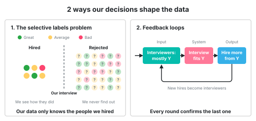

The **selective labels problem** describes the situation where our past choices blind us to the true outcomes. The best example is hiring: we only ever learn how the people we _did_ hire turned out, never how the others _would_ have done.

The **feedback loop** happens when the output of a system circles back to influence its own input. To continue with the hiring example: most of our interviewers are from school Y, so the interview questions match what school Y teaches. Y candidates do better in the interviews, so we hire more of them. They become interviewers too, and the interview fits Y even more.

## How much do you trust your hiring process?

How good is your hiring? How sure are you that you are **actually selecting the finest candidates** or that you are **rejecting the right candidates**?

This is something that has always bothered me in IT.

We are all just thrown into interviewing people and are most, most often taught nothing about how to interview well. **We are all junior interviewers, and still we are expected to just review people.**

**After a decision "to reject a candidate" is made, we can never go back and review it. How THEN do we _know_ our decision was correct?!**

For all we know, we might be rejecting all the best candidates and hiring only the poor performers. 

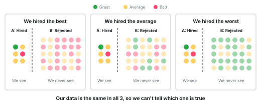 

There is only 1 way to know if the sub-group A is better or worse than sub-group B and that is... **to compare the 2 groups**. But we can never know how good the rejected people would have been as our employees, so we can never compare them. 

If I claimed _"we only hire the bottom 10%"_, **what data would you show to prove I'm wrong?** Such data doesn't exist.
{:.box}

## Friday deploys are the safest deploys, says our data

This is the **selective labels problem**: we only learn the outcome (the "label") for the cases our previous decision let through. Everything else stays unlabeled forever.

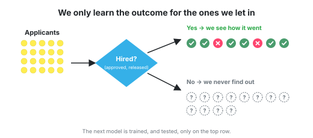

The problem magnifies when we build algorithms on top of such data. Our model learns a connection that's only true for the data points that were selected, not the whole data population. 

Here is a fun example:

Our team has a rule: **no deploys on Friday, unless a senior engineer approves it**. The senior devs only approve a Friday deploy when they know the code well and know the change is safe. So the few Friday deploys we have almost never cause an incident.

Now we train a model to review deploys automatically, but the model doesn't know anything about this rule. It only looks at the stats for every deploy. The model sees that **Friday deploys are very safe**. So... it starts approving every Friday deploy, because **data shows Friday deploys cause no incidents!**

Sure enough, incidents start happening left and right.

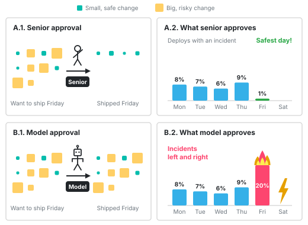{:.breakout}

Rabbit hole: Source of the name "selective labels problem"

The name comes from a 2017 paper by Himabindu Lakkaraju, Jon Kleinberg, Jure Leskovec, Jens Ludwig and Sendhil Mullainathan: _"The Selective Labels Problem: Evaluating Algorithmic Predictions in the Presence of Unobservables"_.
 
Their paper deals with the question: how can we evaluate whether "machines improve on human performance".

Their starting example was the US judicial bail decisions. In a bail hearing the judge has to decide whether to release the person on bail or not. The underlying concern is whether the person will return for their court appearance without committing a crime in the meantime.

> First, judges’ predictions rely on many informative features that are **unobservable to the algorithm** because they aren’t recorded in available datasets; [..]. Second, the labels we are trying to predict correspond to whether a defendant returned for their court appearance without committing a crime [...]. But if a defendant is denied bail, **then there is no opportunity for them to commit a crime** [...]. So **how do we evaluate an algorithm that proposes to release someone that the judge had jailed in the dataset?** This results in a problem of **selective labels**: the process generates only a partial labeling of the instances, and the decision-maker’s choices — the very decisions we wish to compare the algorithm to—determine which instances even have labels at all.
<figcaption>
&mdash; Lakkaraju et al.: The Selective Labels Problem
</figcaption>

Why is this selective labeling such a problem?

Because the judge's extra information leaks into the data. Their example was about young defendants, where it matters a lot if their family shows up at the hearing. A good judge notices that and releases the young people with family support. But "family was there" isn't recorded in the dataset, so a model trained on this data concludes that young defendants in general are low risk. When such a model gets released "into production" it suggests releasing young people without family support too, because it learned that young defendants rarely fail. Now, suddenly, we will get way more released young defendants who did commit crimes or didn't show up for their court date.

The usual fix for missing data, running an experiment and randomly releasing some people to see what happens, is not an option here. You can't release defendants or withhold medical treatment at random just to get better data.

Their solution was a new approach they call **contraction**. Explaining it is a bit outside of this post, so... you can read about it in the original paper.

## A live demo will always fail spectacularly

Then there is the **feedback loop**: our choices become "proof" that we were right all along, so we make the same choices again, and again we are "proven" right, so we make them even more.

Sometimes, it's easy to see through such behavior. Think of all sorts of superstitions like Friday the 13th being an unlucky day.

Other times they are harder to break away from: _"A live demo of a new product will always fail spectacularly"_. 

If we believe this, it's because **we got burnt with a demo** once or twice. From that time on we are making sure to always have **a recorded version of the demo**, to never have to demo anything live again, and as we demo features from recordings, we **fill our dataset with examples of when "everything went well, when we showed a recorded demo"**.

And since we never practice live demos anymore, the one time we're forced to do one, it goes badly... see? Live demos always fail.

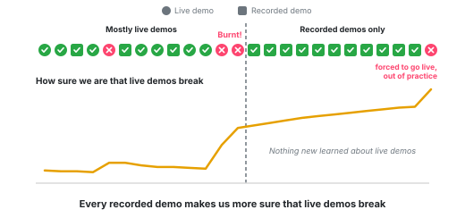

## We promote based on impact

**Who would you promote at your company?**

Hopefully somebody **who has performed really well.**

**But how can we compare performance?** Surely, it's not the number of pull requests opened or the number of issues closed or the lines of code merged into `master`, right? But how then?

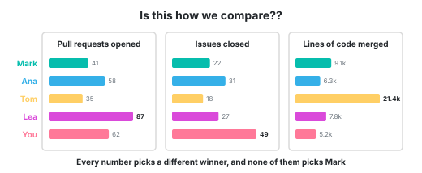

Well... I guess it must be somehow tied to what is **profitable for the company**, either in the short or the long term.

So, then, who gets promoted? **Somebody who has successfully delivered a project that is important for the company.**

This means... **if _you_ want a chance at a promotion, you _first_ have to get your hands on an important project.** For all intents and purposes, small projects don't count. No important project, no promotion!

**But who gets the important projects?** Of course, people who have proved that they can be trusted to deliver on them. So... this is kinda a catch-22. You need big projects to prove yourself, but you can only get them after you've proven yourself. Quite... problematic.

And it keeps going: **whoever got the first big project gets promoted, is trusted more, and gets the next big project too. Every round, the gap between them and everybody else grows. This is a feedback loop**.

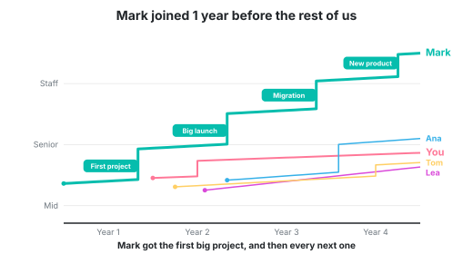
  
And when you look at the data, you see:

{:.table-small .last-column}
| Dev | Joined | Projects | Delivered well | Big projects | "Impact" on the dashboard |
|-----|--------|----------|----------------|--------------|---------------------------|
| Mark | 2018  | 22       | 15 (68%)       | 9            | ⭐⭐⭐⭐⭐                |
| You  | 2020  | 10       | 8 (80%)        | 1            | ⭐⭐                      |

Data doesn't lie, right? So we can't change the fact that it really is _Mark_ who has a much greater positive impact on the company.

There is a trick out of this problem

**There is a trick**, though, a way out of this problem. Inexperienced developers get more chances to prove themselves in one specific situation: taking on a risky project. Usually this translates to joining a startup. Sooo much needs to be built in startups and soo few people are available.

This doesn't mean that if you go into a startup, you'll be a principal architect in 5 years. It's just about the number of opportunities you are presented with.

People have always done this throughout history, going where they perceived the opportunities to be.

America used to be the land of opportunity, because in Europe the opportunities were simply very, very, very few. Not because everybody was guaranteed to succeed. But, of course, by now the opportunities aren't quite what they used to be, just like in startups after they grow into big companies.

## How to plant the promotion

**How to promote your favorite, without anyone noticing:**

1. From Jan to May, give them all the most impactful projects.
2. Give everybody else the flaky tests problem and the Python library upgrade project.
3. By late autumn, the numbers should be in: your favorite will look _pretty_ favorably compared to other devs.

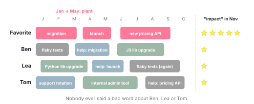

The fix is not a better formula or a better chart, and it's for sure not more training for developers (to level them up), nor for managers (to fight their various biases). 

**The solution is to first track how we distribute the opportunities and then to possibly adjust this process.**

## The rich are getting richer

I would love to say my example above is just a theoretical scenario and that in the real world meritocracy rules, but I'd be lying.

Life is not fair. Just as rich people get richer, successful people get even more successful:
- The **speaker who was on stage last year** gets invited again, because organizers want "proven speakers". And how do _you_ become a proven speaker? By being on stage last year.
- The **candidate with Google on their CV** gets the interview. Getting the interview is how you get the next big name on your CV.
- The senior dev gets added as **a reviewer on every PR**, because they "know the codebase". They know it because they review every PR. <- **And this was me at my last company.**
- The **team that shipped on time last quarter** gets the budget and the best hires. The team that struggled gets nothing, and struggles more.
- The **biggest customer** gets their feature requests built first, so the product fits them better, so they buy more seats, so their next request jumps the queue too. The small customers' requests rot in the backlog.
- We pick the **language the team already knows**, so we hire people who know it, so the team knows it even better. Nobody ever tries the alternative.

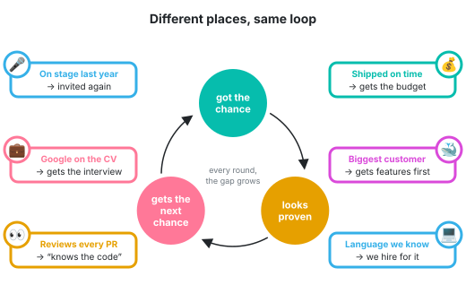

**This is not necessarily a bad thing. Often the end result is simply a very specialized solution.** The speaker who spoke more really is proven, and the candidate who worked at Google really does have that experience, and the person who reviews all PRs really does know the codebase best. It is just not fair. 

## Luck accumulates

In 2018 a fun study was published that quantified the cumulative effect of the feedback loop for 1 particular example.

In the Netherlands, young researchers can apply for an early-career grant called Veni, worth €250,000. A committee scores all the proposals, everybody above a certain score gets the money and everybody below gets nothing.

The researchers looked at the people right around that line, **people who just got the grant (=winners) and people who just missed it (=near-winners)**. The grant threshold could easily have been drawn at a different cutoff. These 2 groups of people are very similar. **It is mostly luck that determines which side of the line you fall on** (again: I'm talking about people just above and below the line, not those who were far above or below it).

What is the effect of this luck 8 years later?

Turns out that winners collected €180,000 more in later grants than the near-winners. They were 2.5 times more likely to win the next, bigger grant, and more likely to end up as full professors.

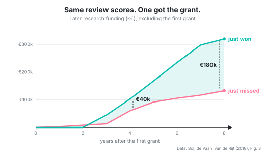

The winners didn't publish more papers or get more citations than the near-winners, not before the grant and not after.

A worrying trend was also that a lot of the near-winners simply stopped applying. Only 40% of them tried for the next grant, versus 59% of the winners. They didn't know that they had missed by a hair. All they knew was that they lost... so they counted themselves out.

Sociologists call this the **Matthew effect**: whoever already has gets more, mostly because they already have it.

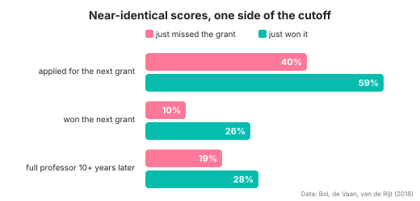

Rabbit hole: Predictive policing

Sometimes the feedback loops are very dangerous. One such example is **predictive policing.** 

The idea seems so very, very **plausible**: use past crime data to decide where to send the patrols.

There is just 1 problem with it and it's a **feedback loop**:

- You send police into neighborhood D and not S.
- 1 crime happens in neighborhood D and one in neighborhood S.
- Since the police are in neighborhood D, they record that crime and not the one in the other neighborhood. 
- Next day you have real data that the neighborhood D is more dangerous than neighborhood S.
- You send the police to neighborhood D again. And again, they only record crime in this neighborhood.
- After a few rounds, the model is very confident that D is dangerous and S is safe. Even if both neighborhoods have exactly the same amount of crime.
{:.steps}

Ensign and co-authors showed in 2018 that this loop "runs away" mathematically: the system keeps sending more patrols to the same place, and the data it collects always seems to confirm it was right.

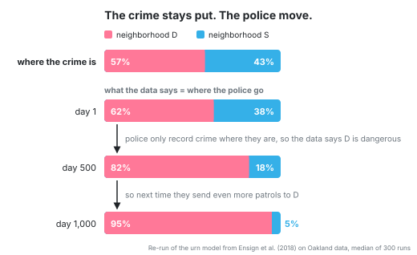

**The model is not measuring crime. It's measuring where the police were.** And the people who live in neighborhood D are the ones who get stopped, searched and arrested, because of a loop that a developer shipped.

## Can you spot the selective labels and the feedback loops?

Some of these are both.

####  "The top search result is clearly the best answer, people click it way more than the rest."

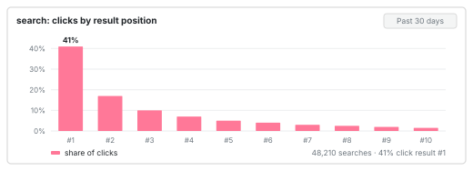

The top result gets **the most clicks, because it's on top**. The ranking model learns that people click it a lot, so it must be the best result. So it stays on top.

####  "Our fraud model catches 98% of all fraud."

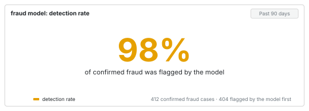

Humans only review the transactions the model flags. Only reviewed transactions can be confirmed as fraud, and only confirmed fraud goes back into training. So the model learns to catch exactly the fraud it already catches. A new trick never gets flagged, never gets reviewed, and never shows up in the missing 2%.

####  "Our churn model is useless, most of the customers it flagged didn't churn."

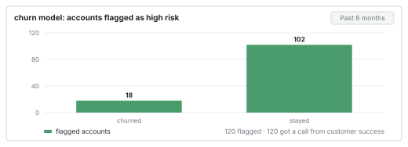

**Customer success calls every account the model flags**, and talks most of them into staying. So the flagged customers mostly don't churn, and the model looks wrong. We'll never know how many of them would have left without the call, because we called all of them.

####  "None of the alerts we muted were ever real incidents."

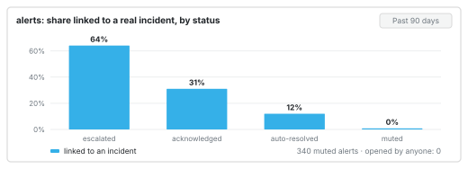

Nobody looks at a muted alert. That's the whole point of muting it. **So nobody ever links a muted alert to an incident**, and the data says muting was the right call.

####  "The firewall blocked 12,000 attackers last month."

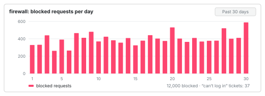

**Blocked requests never reach the app**, so we never learn who was behind them. Some were attackers, sure. Some were customers on hotel Wi-Fi or a VPN, who got an error page and quietly went to a competitor. The firewall counts all of them as attackers, because it never sees what they would have done.

####  "Lea is responsible for all our billing bugs."

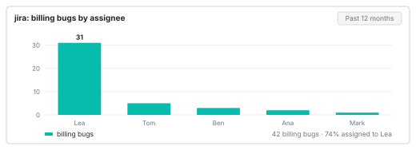

The bot assigns new bugs to whoever fixed similar bugs before. A developer who fixed a few billing bugs last year now gets all the billing bugs, and her name is on every billing ticket. Next year, she looks like the person who is responsible for all billing bugs.

####  "Nobody uses the Export feature."

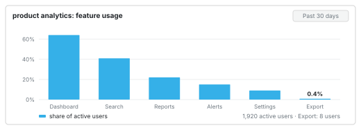

The feature sits nested deep in some settings menu, so nobody finds it. Analytics says nobody uses it, so it never gets improved or moved somewhere visible. So nobody finds it next year either.

####  "Nobody uses Firefox, it's not worth testing on it."

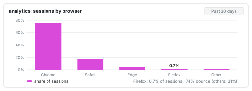

We never test on Firefox, so half the buttons don't quite work there. Firefox users try once, give up and leave. Analytics says almost nobody uses Firefox, so it's not worth testing on. So we never test on Firefox.

## What can we do?

**Keep in mind that your data is a sample, not the full truth.**

Ask: who is missing from your dataset? The rejected candidates, the unflagged transactions, the search result on page 2, the Firefox users...

An interesting idea is to mix it up a bit: 
- Let one borderline candidate through to the next round, even though they'd normally be out.
- Give the next big project to someone who has never had one.
- Don't call 10% of the accounts the churn model flags.
- Review a random 1% of the transactions the model didn't flag.
- Move some obscure feature into the main menu for a month and watch whether usage moves.

Test your old beliefs from time to time.

Before we trust numbers and averages, why not put the dataset itself under the microscope?
