What do you do when you change tams??? I had a bit of free time, so of course I asked Claude to turn the last 6&frac34; years into charts.

It's such a weird thing... to see what I've been up to for the last ~7 years, I've already forgotten about half of these projects, that seemed so very important at the time.

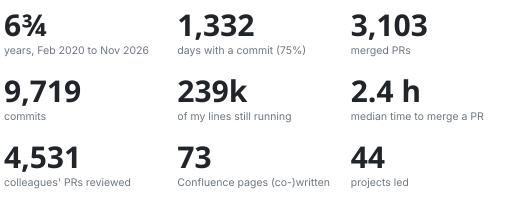 

## About 40 PRs a month, every month, for almost 7 years

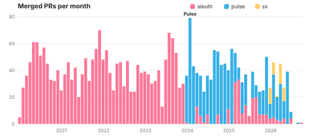

The peak, March 2024 with 79 PRs, came in the first weeks of building Pulse, right after the fork. 

Months usually have about 21 working days, so.. 79 seems somewhat excessive.

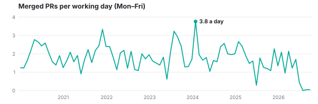


## Who was writing code with me

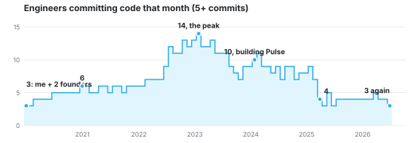

I counted only people, who had at least 5 commits that month. We started as 3, grew to 14, and ended as 3 again. Funny how that works.

## 463k lines of code written, 317k changed or removed

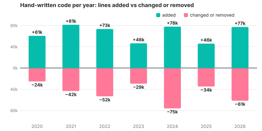

Hand-written code only (Python, Go, JS/TS), from my commits on the main branches. Generated files (GraphQL schema dumps, JSON test cassettes, lock files, migrations) are left out.

## 239k of my lines are still running today

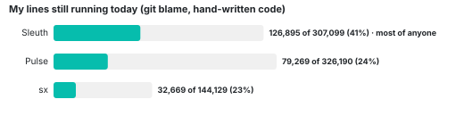

Generated code, test fixtures, mock data and migrations are left out of both my lines and the total. 

In Sleuth, I'm the author of more surviving lines than anyone else.

The oldest line of real code of mine that is still running is from my second week, 4 March 2020:

```python
return HttpResponse(status=401)
```

And the oldest whole class is `BaseDevCommand` from 10 March 2020, the base for our local dev commands.

## I reviewed 4,531 of my colleagues' PRs, 42% of all of them

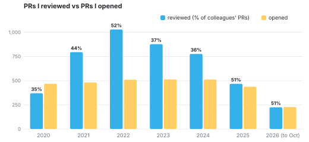

**Median time until my first review: 26 minutes** over all 6¾ years, and only 7 minutes in 2024.

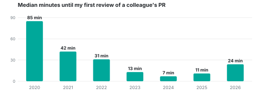

Counts include every team. Review speed counts only the EU team's PRs (same rules as in [Exhibit D](/2026/10/26/blind-spots-in-code-part-IV.html)), so the numbers differ slightly from that post.

## 16 tech specs, 13 proposals, 9 investigations: 73 Confluence pages in total

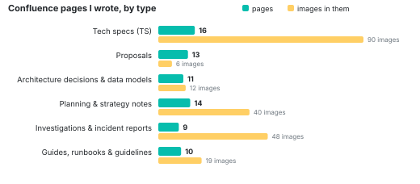

I found it fun to look at my avg number of pics on a page, because "an image is 1000 words".

On top of the pages, I wrote 495 Confluence comments.

## 1,332 days with at least one commit

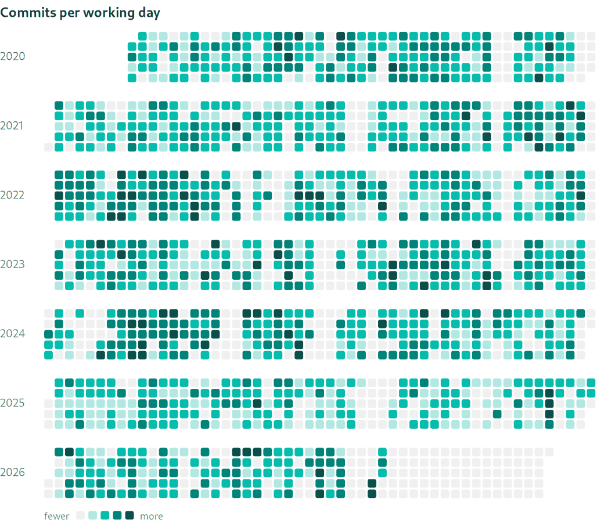

One square per working day. The darker the square, the more commits that day. **The record is 62 commits in one day (7 August 2026).**

## Office hours: 97% of commits between 9:00 and 18:00

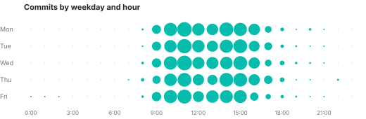

Most commits land around 11:00 and 15:00, with a lunch dip at 13:00.

## The median PR changes 87 lines, the p99 PR changes 5,028

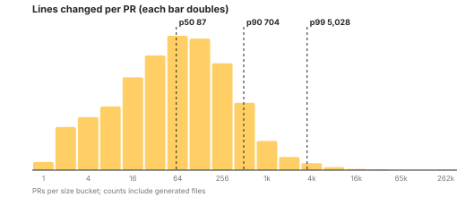

136 PRs changed 2 lines or fewer. The biggest deleted 266,439 lines. GitHub's counts include generated files (schema dumps, test cassettes), so the big PRs look bigger than the actual code change.

## Half my PRs merged within 2.4 hours

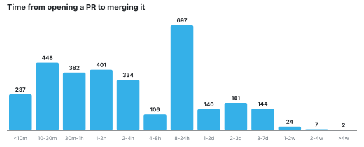

Time from opening a PR to merging it, so time spent as a draft counts too. 1,067 PRs merged within an hour, and 237 within 10 minutes. p90 is 67 hours, which is roughly a weekend: open on Friday, merge on Monday.

## PRs got faster to merge, but not smaller

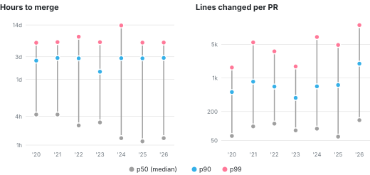

p50, p90 and p99 per year, on a log scale. The 2026 jump in PR size is partly generated Go code in sx.

## "Add" and "Fix" lead, then "Delete"

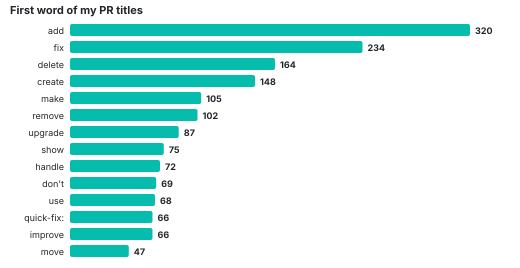

## 46,000 words and 983 images in PR descriptions

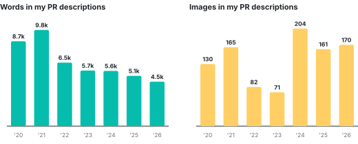

About half of my PRs have a real description. Together that's about 46,000 words, not counting code blocks and links... and 983 images in 498 PRs. **The record is 16 images in a single PR.**

The longest descriptions have: 421 words, 414 words, and 398 words.

## On the side: 41 blog posts and 11 conference talks

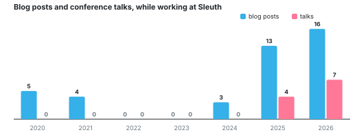

While working at Sleuth, I wrote 41 posts on this blog and gave 11 conference talks in 8 countries, all in 2025 and 2026. (Ok, technically 10: I was fully prepared for TDC in Trondheim, had taken vacation days, and then flight trouble kept me from getting there. I'm counting it anyway.)

## The forget-me-nots

This is to remember what I worked on, because as I move on, new projects overwrite my memory space.

<div class="ptl">
<div class="ptl-legend"><span><i class="ptl-dot ptl-res"></i>Integrations & resilience</span><span><i class="ptl-dot ptl-met"></i>Metrics</span><span><i class="ptl-dot ptl-data"></i>Data & migrations</span><span><i class="ptl-dot ptl-job"></i>Jobs & concurrency</span><span><i class="ptl-dot ptl-tool"></i>Python & tooling</span><span><i class="ptl-dot ptl-ai"></i>AI</span><span><i class="ptl-dot ptl-comm"></i>Communication</span></div>
<div class="ptl-year">2020</div><p class="ptl-era">Sleuth: deploy tracking</p>
<div class="ptl-item"><div class="ptl-when">2020-04 → 2021-04</div><div><div class="ptl-title"><span class="ptl-dot ptl-comm"></span>Personalized Slack notifications for every deploy <span class="ptl-repo">sleuth</span></div></div></div>
<div class="ptl-item"><div class="ptl-when">2020-05 → 07</div><div><div class="ptl-title"><span class="ptl-dot ptl-met"></span>First impact metrics (datadog) <span class="ptl-repo">sleuth</span></div></div></div>
<div class="ptl-item"><div class="ptl-when">2020-06</div><div><div class="ptl-title"><span class="ptl-dot ptl-res"></span>Telling missing data from actual zero in third-party API results <span class="ptl-repo">sleuth</span></div></div></div>
<div class="ptl-item"><div class="ptl-when">2020-08</div><div><div class="ptl-title"><span class="ptl-dot ptl-tool"></span>Encryption at rest for all integration tokens <span class="ptl-repo">sleuth</span></div></div></div>
<div class="ptl-item"><div class="ptl-when">2020-10 → 12</div><div><div class="ptl-title"><span class="ptl-dot ptl-job"></span>Gevent workers for Celery <span class="ptl-repo">sleuth</span></div></div></div>
<div class="ptl-item"><div class="ptl-when">2020-10 → 2021-04</div><div><div class="ptl-title"><span class="ptl-dot ptl-met"></span>Impact ostracization: auto-detecting and then disabling faulty integrations <span class="ptl-repo">sleuth</span></div></div></div>
<div class="ptl-item"><div class="ptl-when">2020-11 → 2021-04</div><div><div class="ptl-title"><span class="ptl-dot ptl-met"></span>Anomaly detection for metrics (outliers, DBSCAN) ⭐ <span class="ptl-repo">sleuth</span></div></div></div>
<div class="ptl-year">2021</div><p class="ptl-era">DORA metrics</p>
<div class="ptl-item"><div class="ptl-when">2021-04 → 06</div><div><div class="ptl-title"><span class="ptl-dot ptl-met"></span>DORA metrics on Elasticsearch for speedy charts <span class="ptl-repo">sleuth</span></div></div></div>
<div class="ptl-item"><div class="ptl-when">2021-08 → 2022-01</div><div><div class="ptl-title"><span class="ptl-dot ptl-met"></span>Health history: MTTR and change failure rate rebuilt ⭐ <span class="ptl-repo">sleuth</span></div></div></div>
<div class="ptl-item"><div class="ptl-when">2021-09 → 2023-11</div><div><div class="ptl-title"><span class="ptl-dot ptl-tool"></span>Gradual static typing for the whole codebase with a MyPy ratchet in CI ⭐ <span class="ptl-repo">sleuth</span></div></div></div>
<div class="ptl-item"><div class="ptl-when">2021-10 → 2022-01</div><div><div class="ptl-title"><span class="ptl-dot ptl-data"></span>Solving millions of writes to the same Postgres table by moving data into a Redis data structure  ⭐ <span class="ptl-repo">sleuth</span></div></div></div>
<div class="ptl-year">2022</div><p class="ptl-era">Health, teams, integrations</p>
<div class="ptl-item"><div class="ptl-when">2022-01 → 02</div><div><div class="ptl-title"><span class="ptl-dot ptl-met"></span>Org-level metrics dashboard <span class="ptl-repo">sleuth</span></div></div></div>
<div class="ptl-item"><div class="ptl-when">2022-02 → 07</div><div><div class="ptl-title"><span class="ptl-dot ptl-met"></span>Team-level metrics dashboard <span class="ptl-repo">sleuth</span></div></div></div>
<div class="ptl-item"><div class="ptl-when">2022-03</div><div><div class="ptl-title"><span class="ptl-dot ptl-job"></span>Race-condition fix with Postgres advisory locks <span class="ptl-repo">sleuth</span></div></div></div>
<div class="ptl-item"><div class="ptl-when">2022-08 → 09</div><div><div class="ptl-title"><span class="ptl-dot ptl-res"></span>Redis-backed circuit breaker for all integrations ⭐ <span class="ptl-repo">sleuth</span></div></div></div>
<div class="ptl-item"><div class="ptl-when">2022-08 → 09</div><div><div class="ptl-title"><span class="ptl-dot ptl-data"></span>Multi-tenant cleanup of external user identities <span class="ptl-repo">sleuth</span></div></div></div>
<div class="ptl-item"><div class="ptl-when">2022-10 → 11</div><div><div class="ptl-title"><span class="ptl-dot ptl-tool"></span>GraphQL library migration with 0 downtime and 18,000 LOC ⭐ <span class="ptl-repo">sleuth</span></div><p class="ptl-meta">31 PRs over 7 weeks</p></div></div>
<div class="ptl-item"><div class="ptl-when">2022-12 → 2023-10</div><div><div class="ptl-title"><span class="ptl-dot ptl-job"></span>Reliable Celery program: general task rules, dead-letter queues, acks_late ⭐ <span class="ptl-repo">sleuth</span></div></div></div>
<div class="ptl-year">2023</div><p class="ptl-era">Background jobs and cleanups</p>
<div class="ptl-item"><div class="ptl-when">2022-12 → 2023-01</div><div><div class="ptl-title"><span class="ptl-dot ptl-job"></span>Splitting the webhook task: sharding and solving deadlocks <span class="ptl-repo">sleuth</span></div></div></div>
<div class="ptl-item"><div class="ptl-when">2023-01 → 04</div><div><div class="ptl-title"><span class="ptl-dot ptl-tool"></span>Task observability: parent task IDs in logs, side effects split out, admin tooling <span class="ptl-repo">sleuth</span></div></div></div>
<div class="ptl-item"><div class="ptl-when">2023-05 → 08</div><div><div class="ptl-title"><span class="ptl-dot ptl-res"></span>Background sync system for third-party data <span class="ptl-repo">sleuth</span></div></div></div>
<div class="ptl-item"><div class="ptl-when">2023-06</div><div><div class="ptl-title"><span class="ptl-dot ptl-job"></span>DB performance <span class="ptl-repo">sleuth</span></div></div></div>
<div class="ptl-item"><div class="ptl-when">2023-08 → 11</div><div><div class="ptl-title"><span class="ptl-dot ptl-tool"></span>Rules engine rewrite for functional cohesion <span class="ptl-repo">sleuth</span></div></div></div>
<div class="ptl-item"><div class="ptl-when">2023-11</div><div><div class="ptl-title"><span class="ptl-dot ptl-res"></span>Incident sync error handling for 6 providers <span class="ptl-repo">sleuth</span></div></div></div>
<div class="ptl-item"><div class="ptl-when">2023-11 → 12</div><div><div class="ptl-title"><span class="ptl-dot ptl-met"></span>Excluding PRs from lead-time metrics <span class="ptl-repo">sleuth</span></div></div></div>
<div class="ptl-year">2024</div><p class="ptl-era">Pulse</p>
<div class="ptl-item"><div class="ptl-when">2024-03</div><div><div class="ptl-title"><span class="ptl-dot ptl-res"></span>Resumable GitHub sync: Celery retries after the rate limit and continues from the same page <span class="ptl-repo">pulse</span></div></div></div>
<div class="ptl-item"><div class="ptl-when">2024-05 → 2025-04</div><div><div class="ptl-title"><span class="ptl-dot ptl-res"></span>HTTP client framework for all integrations, with rate limiting and pagination built in ⭐ <span class="ptl-repo">pulse</span></div></div></div>
<div class="ptl-item"><div class="ptl-when">2024-07 → 12</div><div><div class="ptl-title"><span class="ptl-dot ptl-tool"></span>PQL: a typed query language (pyparsing) ⭐ <span class="ptl-repo">pulse</span></div></div></div>
<div class="ptl-item"><div class="ptl-when">2024-10 → 2025-03</div><div><div class="ptl-title"><span class="ptl-dot ptl-met"></span>Time-allocation calculator: hours of work per developer per issue category, estimated from Jira status history<span class="ptl-repo">pulse</span></div></div></div>
<div class="ptl-item"><div class="ptl-when">2024-11 → 2025-02</div><div><div class="ptl-title"><span class="ptl-dot ptl-met"></span>Explainable metrics: Excel exports and auto-notes <span class="ptl-repo">pulse</span></div></div></div>
<div class="ptl-year">2025</div><p class="ptl-era">Pulse and Sleuth</p>
<div class="ptl-item"><div class="ptl-when">2025-01 → 02</div><div><div class="ptl-title"><span class="ptl-dot ptl-data"></span>Identity resolution across GitHub, Jira and Slack <span class="ptl-repo">pulse</span></div></div></div>
<div class="ptl-item"><div class="ptl-when">2025-04 → 05</div><div><div class="ptl-title"><span class="ptl-dot ptl-res"></span>Tool ostracization: auto-disabling failing tool installations <span class="ptl-repo">sleuth</span></div></div></div>
<div class="ptl-item"><div class="ptl-when">2025-06 → 07</div><div><div class="ptl-title"><span class="ptl-dot ptl-data"></span>Jira custom fields as query-language tags <span class="ptl-repo">pulse</span></div></div></div>
<div class="ptl-item"><div class="ptl-when">2025-08 → 09</div><div><div class="ptl-title"><span class="ptl-dot ptl-data"></span>Search migration from Elasticsearch to OpenSearch <span class="ptl-repo">sleuth</span></div></div></div>
<div class="ptl-item"><div class="ptl-when">2025-09 → 10</div><div><div class="ptl-title"><span class="ptl-dot ptl-res"></span>Hardening the Jira and Linear API clients: Cloud vs Data Center, pagination, rate limits <span class="ptl-repo">sleuth</span></div></div></div>
<div class="ptl-item"><div class="ptl-when">2025-10 → 11</div><div><div class="ptl-title"><span class="ptl-dot ptl-met"></span>Working hours for work-in-progress items <span class="ptl-repo">sleuth</span></div></div></div>
<div class="ptl-item"><div class="ptl-when">2025-11 → 2026-03</div><div><div class="ptl-title"><span class="ptl-dot ptl-ai"></span>Skills check: Claude reads each merged PR and opens a PR when a team skill is out of date <span class="ptl-repo">pulse</span></div></div></div>
<div class="ptl-item"><div class="ptl-when">2025-12</div><div><div class="ptl-title"><span class="ptl-dot ptl-tool"></span>Moving Sleuth and Pulse to ruff: one linter and formatter instead of three <span class="ptl-repo">sleuth + pulse</span></div></div></div>
<div class="ptl-year">2026</div><p class="ptl-era">AI tools</p>
<div class="ptl-item"><div class="ptl-when">2026-02 → 03</div><div><div class="ptl-title"><span class="ptl-dot ptl-ai"></span>sx CLI (Go): support for Copilot, Codex, Gemini, Cline and Kiro <span class="ptl-repo">sx</span></div></div></div>
<div class="ptl-item"><div class="ptl-when">2026-06</div><div><div class="ptl-title"><span class="ptl-dot ptl-ai"></span>Role-based access control (RBAC) for sx <span class="ptl-repo">sx</span></div></div></div>
<div class="ptl-item"><div class="ptl-when">2026-06 → 07</div><div><div class="ptl-title"><span class="ptl-dot ptl-ai"></span>AI usage report: LLM pipeline with privacy screening <span class="ptl-repo">pulse</span></div></div></div>
</div>

## Awards

- **Most reverted:** gevent workers. Merged and reverted 4 times in 3 weeks (Nov to Dec 2020) before it stuck.
- **Best branch name:** `graphene-v3-again-again`. Merged, reverted, relanded as "Graphene V3 Still".
- **Biggest delete:** −266,439 lines. "Delete all in-active apps", 1,971 files.
- **Most ironic title:** "Simple things to make the other PR smaller". The biggest addition of all: +62,121 lines. Pulse, 2024.
- **Slowest merge:** 118 days. Also called "Delete all in-active apps", the first of two PRs with that title. Pulse, 2024.
- **Fastest merge:** 14 seconds. A revert, of course: Revert "Exclude ignored PRs". 2023.
- **Busiest day:** 62 commits, 7 August 2026.
- **Most PRs merged in one day:** 10 PRs, 24 January 2022.
- **Most honest:** "Speed up MTTR + ES fix, probably". 2022.
- **Most self-aware:** "Show insights in email (in an ugly way)". 2021.
- **Most careful:** "Improve migration: make it waaaaaaay slower". 2022.
- **Most philosophical:** "Less than 24h is still 1 day". 2024.
- **Most exciting punctuation:** "Change [!] to [!]!". 2026.
- **First sign of things to come:** "Temp. skip the most flaky test". My first months, 2020.


Well, this was a silly way to spend 4h... hunting down data, double checking it. Weren't LLMs supposed to make us faster?

But it is also a fun thing to have, a measuring stick, if you will, for my future jobs. I now also wish I still had data from some previous jobs, to have something to compare these stats to.. oh well. 
