Many task libraries offer 2 kinds of message acknowledgements: early and late. Late is superior to early, but none is fool-proof and it comes with strings.



## The contract

The exact terms of the broker's contract are: **_I, the broker, will hold your message/task for as long as no worker acknowledges said message/task_.**

I think we all fully understand this statement. The thing we often miss is the natural consequence of this statement: **once a worker acknowledges it, the broker deletes said message/task.** "Deletes" as in actually deletes it. Unless _we_ have put systems in place on our side to keep a trace of the task.

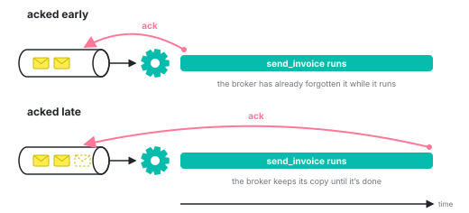

## The benefits and the drawbacks

- **Early** `ack`: The task will run **at most once**. Could be 0×, could be &frac12;×. 
- **Late** `ack`: The task will run **at least once**. Could be 2×, could also be 3× &frac12;, 1× &frac14;, and 1× for real. 

**In a theoretical system, the task would run precisely 1× in both cases.** It is the unpredictability of the real world, where workers dare to crash mid-work, that creates the need for re-runs.

The question you should ask yourself is: **_"do I prefer that my task occasionally doesn't run at all or that it occasionally runs two times?"_**.
{:.box}

## Late `ack` is the preferred solution

**Most often we want the late `ack`.** 

If the task was supposed to send an email, and it didn't, then let it try again. If the task was supposed to subscribe a user, and it didn't, then let it run again. If the task was supposed to report the request time, and it didn't, then let it run again (_I think_).

**But what about a complex task?** A task that subscribes the user, then sends an email, then reports some metrics. Maybe what we'd want in the ideal world is to acknowledge right after the email is successfully sent, because we never want to send 2 emails, even if we have to pay with missing metrics. But will we really maintain a bunch of tasks, where the `ack` can be in between any 2 lines? We'll probably keep this power-feature for only very delicate tasks. 

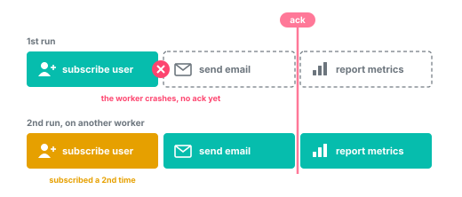

What we need to keep in mind for late `ack` is: the "other" runs will be partial. We aren't talking about the task running twice from start to end. This usually changes the mental model people have. 
{:.box}

## The biggest overlooked consequence of late `ack`

If we want to truly use late `ack`, then we must make sure our tasks are **truly idempotent**. This means that running them once or running them five times must produce the same side effects.

This sounds like such a simple limitation, **but it's actually a can of worms.**

Idempotency must not be checked only once, at the beginning of the task, but before every action. 

There are levels to idempotency. But the deeper you go, the more you will fear you are over-engineering. It's about balancing the code complexity with the frequency of worker-failure. Nothing in our system is 100% reliable nor can it be 100% reliable.

## Idempotency level 1

If your task is simple, and it does only 1 thing, then theoretically that 1 thing can be in only 2 states: done or not done.

So, idempotency can be achieved with 1 simple if-statement: `if not_done: do_it()`.

Even better, some operations (like SQL `UPSERT`, or the SQL `INSERT` + unique constraint) don't even need the `if`, because they themselves are already idempotent.

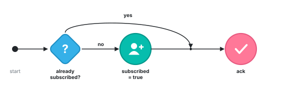

## Idempotency level 2

But tasks quickly have more than 1 action. Now, we need to guard every action, because **the previous run might have died anywhere in the chain!**

It's not enough to check the beginning of the task, if it has been run already. We must assume that some number of steps have already successfully completed, but the others have not.

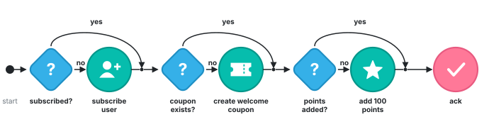

## Idempotency level 3

**What about tasks with an API call?** Or any call to a separate system, like SMTP for sending emails. 

Here, calling the API and recording that the call was made are 2 steps, 2 independent steps.

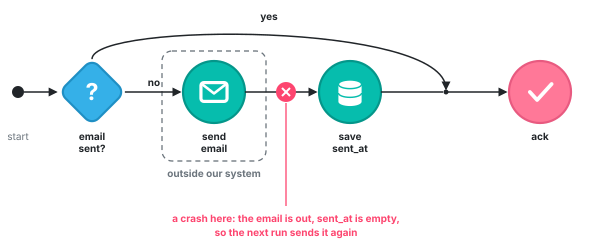

There is no great solution here. We can save before sending and accept a rare missing email, or we can save after sending and accept a rare duplicate email. A duplicate welcome email is harmless, a duplicate payment email hurts the company's reputation. 

Or we can go crazier: if our email provider accepts an idempotency key, we can mark the email with some uniqueness key like `welcome-email-user-42`, and the provider will ignore a second request with the same key (for a while). This way, we can re-run the task and re-send the email and be pretty sure the user did not get a duplicate.

## Idempotency level 4

Sometimes the timing matters. What if the user subscribed and then 15 mins later she unsubscribed, but our subscribe task was lost somewhere and is only now about to run?

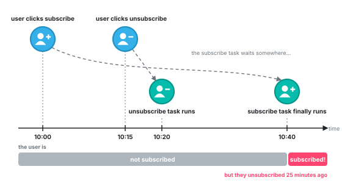

This means that our old subscribe-action-gate is inadequate. **We need to add a check _"is this action still needed?"_.** 

We can't modify the task that is waiting in some queue, but we can store the user's actions separately, with a timestamp... making sure that the order of operations is correct or that one button click can cancel a previous button click.

The background task libraries don't guarantee any particular order. Sure, the brokers line the messages in a FIFO queue, but once you have several workers taking from the same queue, the order gets muddled. Logs like Kafka guarantee order, but then again, only within one partition.

Now, I'm imagining a developer who gets the ticket "Implement unsubscribe API". Are they going to think of this ordering problem? Probably only if they witnessed _things_, bad things. Who in their right mind will remember to raise the concern: "what if a rogue subscribe task is still out there"?

Coding projects are so vast that we can't possibly keep their whole influence graph in our mind at once. We agreed decades ago that the best path forward is to split them into fully independent sub-projects, to keep the graph small and the focus limited. 

In reality, of course, the flap of a butterfly's wings can presumably trigger a tornado.

## Sometimes the `ack`'s timing is off

The broker can't completely leave it up to the worker and wait for `ack` forever. It needs to hold onto every task until the `ack` arrives.

The broker can't tell a dead worker from a very busy, thus very slow, worker. 

**This is why there usually is a master time limit.** If the `ack` doesn't arrive within this limit, the broker assumes the worker has a problem and passes the task to the next free worker.

This adds another layer of complication to our tasks, because **now the same task might be running on 2 workers simultaneously**. Can our task handle that? **Can we extend our idempotency guards to handle this?**

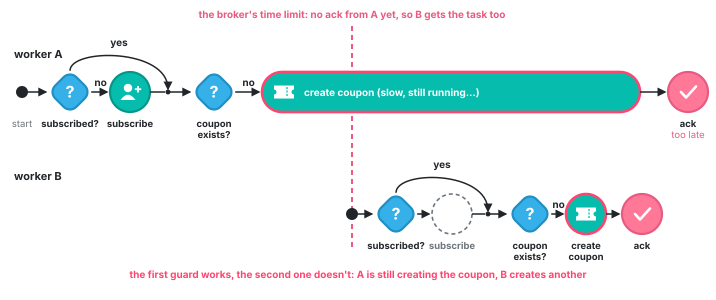

We once had to raise RabbitMQ's limit to 24 hours, because some of our tasks ran for hours. But a long limit has its own price: if a worker really does get stuck, its task also waits that long before anyone picks it up again. Which brings us back to: just don't have long-running tasks. :-P 

## How often do tasks die mid-run?

Seeing how re-runs are a difficult topic, let's shift the focus to: 
- how often does a worker die? 
- why would a worker die?
- why would a task die, if the worker lives on?

**Deploys**

Every time we deploy, we start new workers and shut down the old ones. 

This is usually not done all too gracefully. It of course depends on your custom settings, but ... I'd bet most of us are using the pattern `send SIGTERM (=wrap up), wait 30s, then SIGKILL`. The `SIGKILL` forces an immediate termination by the kernel. Any task that is mid-work gets killed.

We can increase the wait time, but then we increase the deploy time too, and old and new code run side by side for longer. It's not realistic to increase this to more than a few minutes, but we probably have some long-running tasks that need more than an hour. We can never cover for those. 

Deploys have to be fast, because sometimes we need to deploy a bug fix, and we can't run the bad code for another 2h, because a report task is processing some data in the background.

**Scaling down**

This follows the same pattern, `SIGTERM`, then `SIGKILL`. This is arguably worse than a deploy, 
- because it isn't triggered by a deliberate developer action, 
- because it can happen lots of times per day and 
- because the autoscaler can easily be misconfigured: maybe it focused solely on queue length, which is 0, while the worker is busy with a long running task.

**Out of memory (OOM) kills**

A task fetches too many rows from the database or loads a file that's too big, the container hits the memory limit, and the kernel kills the worker. 

**Time limits**

Some libraries have a time limit for how long a task is allowed to run. If it runs longer, it is assumed the task is stuck, so the task's process gets killed.

**Health checks**

Our infrastructure (Kubernetes) does regular liveness checks. But if the worker is busy, like really busy, and doesn't answer in time, then the infrastructure concludes the worker is dead and restarts it.

**Real crashes**

Funnily, this one is (usually) the least common, but it _can_ happen. A segfault in some native library, or some bug that takes the whole process down with it.

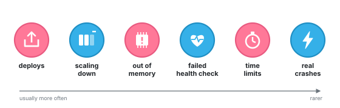

As we see, these events aren't as rare as we'd like them to be. 

We can design our system with more resilience in mind, and make these events less frequent, but... some will still happen.

This is why late `ack` is still the more prudent way forward.

## And in a log (Kafka)

**A log (like Kafka) usually doesn't `ack` single messages.** Every consumer remembers how far it got (its `offset`) and commits that `offset` now and then. It's an `ack` for a whole batch. 

By default, it commits periodically, every 5s. However, this doesn't change the underlying decision that needs to be made: we can only put the commit _before_ the work or _after_ it. 

## Ideas for metrics

What can we monitor to catch the vanished tasks?

Here are some ideas: 

**Started vs finished** 

We count start and end: 
- as the task starts: `statsd.increment("tasks.started")`, 
- once it succeeds: `statsd.increment("tasks.succeeded")`, 
- once it errors out: `statsd.increment("tasks.failed")`. 

A task that dies mid-run never reaches its last line or its error handler, so it gets counted only once, at the start.

Mathematically, it should be:

$$
\text{started} = \text{succeeded} + \text{failed} + \underbrace{\text{running}}_{\le \text{1 per worker}}
$$

The `running` is an estimate. Instead of alerting on an exact number, we can watch the trend, or alert when the difference grows over some level.

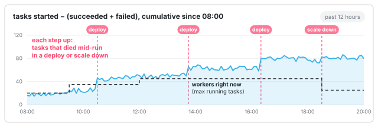

This number will only ever go up, because a task that died and ran again was started twice, but it can only finish once. So we don't look at the height of the line, only at its steps.

**Redeliveries** 

Most brokers report that a task is back again (was delivered to the worker again). We can record this on the first line of the task (`statsd.increment("tasks.redelivered")`).

This is our rerun rate. It doesn't show vanished tasks, but it does show the frequency of tasks dying mid-work.

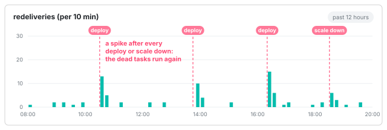

Together with the first chart, this gives us a neat check. A deploy kills 18 tasks, so the first chart goes up by 18. With late `ack`, all 18 tasks come back, so the redeliveries chart shows 18 too. **18 died, 18 came back, nothing is lost.** But if only 15 came back, then 3 tasks are gone for good.

Or, as one metric, counted per day:

$$
\text{lost} = \text{started} - \text{succeeded} - \text{failed} - \text{redeliveries} - \text{running}
$$

Every task that came back cancels the run that died before it, so what's left are the tasks that died and never came back. This line should tend towards 0.

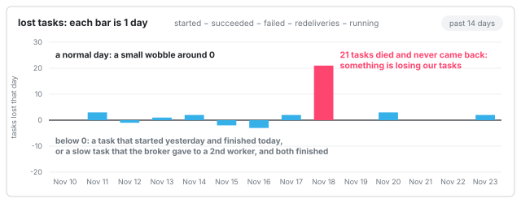
